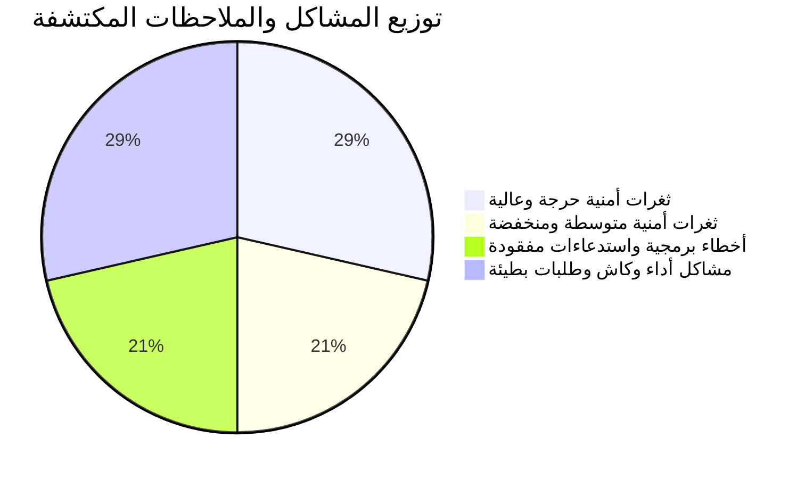
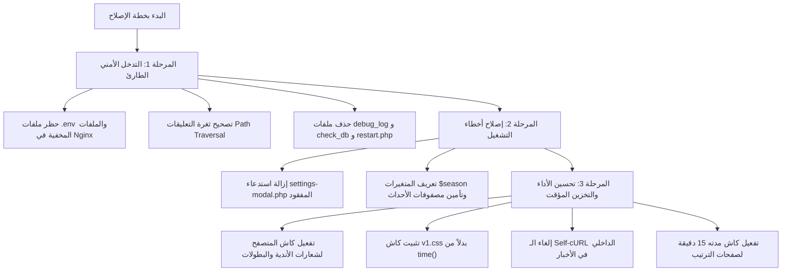

# تقرير الفحص والتدقيق الفني والأمني الشامل لموقع messisporat.com

> **تاريخ الفحص:** أكتوبر 2026  
> **نطاق الفحص:** الكود المصدري للموقع الرئيسي، لوحة تحكم لارافيل (`/admin`)، إعدادات خادم Nginx، أذونات الملفات، وسجلات الأخطاء.

---

## 1. ملخص تنفيذي (Executive Summary)

بعد فحص هيكلية الموقع وسير العمليات البرمجية والبيئة التشغيلية، تبيّن وجود **ثغرات أمنية حرجة تتطلب تدخلاً فورياً**، إلى جانب **أخطاء برمجية نشطة تملأ سجلات السيرفر بالتحذيرات**، و**مشاكل في الأداء والتخزين المؤقت (Caching) تزيد من استهلاك موارد السيرفر وتبطئ تحميل الصفحات**.



---

## 2. الثغرات الأمنية (Security Vulnerabilities)

### 🔴 الثغرة الأولى: كشف ملف البيئة وقاعدة البيانات (.env Exposure) - [CRITICAL]
* **المسار:** `/home/messisporat/htdocs/messisporat.com/public/admin/.env`
* **الرابط العام:** `https://messisporat.com/admin/.env`
* **الخطورة:** **حرجة جداً (Critical)**
* **التفاصيل:**
  ملف `.env` التابع للوحة التحكم متاح للتنزيل المباشر كملف ثابت (`200 OK`) لأي زائر على الإنترنت. تم التحقق من ذلك ويحتوي الملف على:
  - اسم مستخدم وكلمة مرور قاعدة البيانات MySQL (`DB_USERNAME`, `DB_PASSWORD`).
  - اسم قاعدة البيانات (`DB_DATABASE`).
  - مفتاح التطبيق السري (`APP_KEY`) المستخدم في تشفير الجلسات والبيانات.
* **سبب المشكلة:** وضع مشروع لارافيل كاملاً داخل مجلد `public` التابع للموقع، مع غياب قاعدة حظر الملفات المخفية في Nginx.
* **الحل الفوري:**
  1. حظر الوصول لأي ملف يبدأ بنقطة (`.*`) في إعدادات Nginx.
  2. تغيير كلمة مرور قاعدة البيانات فوراً بعد التأمين لأنها اعتُبرت مكشوفة.
  3. نقل مشروع لارافيل خارج مجلد `public`.

---

### 🔴 الثغرة الثانية: مسار غير مقيد وكتابة ملفات عشوائية (Path Traversal & Arbitrary File Creation) - [CRITICAL]
* **الملف:** `/home/messisporat/htdocs/messisporat.com/public/news/view/index.php` (الأسطر 141-149)
* **الكود المصاب:**
  ```php
  if (isset($_GET['id'])) {
      $news_id = htmlspecialchars($_GET['id']);
      $comments_file = $_SERVER['DOCUMENT_ROOT'] . '/news/comments/' . $news_id . '.json';
  }
  if (!file_exists($comments_file)) {
      file_put_contents($comments_file, json_encode([]));
  }
  ```
* **الخطورة:** **حرجة (Critical)**
* **التفاصيل:**
  دالة `htmlspecialchars` تعالج فقط الرموز الخاصة بـ HTML، لكنها **لا تمنع هجمات Directory Traversal** مثل إرسال `../../`. يستطيع المهاجم تمرير معرفات مسارات تؤدي إلى إنشاء ملفات JSON في أي مجلد يملك السيرفر صلاحية الكتابة عليه.
  كما تسببت هذه المشكلة بالفعل في إنشاء آلاف الملفات بأسماء مشوهة مثل:  
  `news/comments/13973434?id=13973434.json`
* **الحل:** التحقق الصارم من أن `$news_id` عبارة عن رقم صحيح فقط:
  ```php
  $news_id = filter_input(INPUT_GET, 'id', FILTER_VALIDATE_INT);
  if (!$news_id) {
      die('معرف الخبر غير صالح.');
  }
  ```

---

### 🟠 الثغرة الثالثة: توكن فيسبوك سري مكتوب مباشرة في الكود (Hardcoded Facebook Token) - [HIGH]
* **الملف:** `/home/messisporat/htdocs/messisporat.com/public/admin/app/Http/Controllers/NewsController.php` (السطر 73)
* **الكود المصاب:**
  ```php
  $pageAccessToken = 'EAAORuHVYg7MBRRkboQMW9KYoS6RNna...';
  $pageId = '902174716319638';
  ```
* **الخطورة:** **عالية (High)**
* **التفاصيل:** تم تثبيت توكن وصول لصفحة الفيسبوك كـ Hardcoded String داخل ملف الكود. أي تسريب للكود أو مستودع Git يعرض صفحة الفيسبوك للاختراق التام والنشر غير المصرح به.
* **الحل:** نقل التوكن إلى ملف `.env` وقراءته عبر `env('FB_PAGE_ACCESS_TOKEN')`.

---

### 🟠 الثغرة الرابعة: ملفات فحص واختبار مكشوفة للعامة (Public Exposed Debug/Utility Scripts) - [HIGH]
* **الملفات:**
  1. `https://messisporat.com/admin/debug_log.php`: يعرض آخر 2000 حرف من سجلات النظام وأخطائه علناً دون أي تسجيل دخول.
  2. `https://messisporat.com/admin/check_connection.php`: يطبع نجاح الاتصال بالقاعدة واسمها.
  3. `https://messisporat.com/admin/check_db.php`: يطبع معلومات عن جداول القاعدة.
  4. `https://messisporat.com/restart.php`: يقوم بعمل `opcache_reset()` بدون أي تحقق أمني، مما يسمح لأي شخص بإلغاء الكاش البرمجي وتكثيف الحمل على المعالج.
* **الحل:** حذف هذه الملفات نهائياً من السيرفر الإنتاجي أو قصر الوصول إليها على IP المدير عبر Nginx.

---

### 🟡 الثغرة الخامسة: ملفات أرشيف وإعدادات متاحة للتحميل المباشر (Public Archives & Config Files) - [MEDIUM]
* **الملفات المكتشفة:**
  - `https://messisporat.com/news/archive.zip` (أرشيف صور قديمة بحجم 35 ميجابايت متاح للتحميل للجميع).
  - `https://messisporat.com/koura.conf` (ملف تكوين أباتشي افتراضي متروك في الـ public).
  - `https://messisporat.com/index_old.php` و `footer_old.php` (نسخ احتياطية غير مستخدمة داخل المجلد العام).
* **الحل:** نقل ملفات الأرشيف خارج مجلد `public` وحذف ملفات التكوين والنسخ القديمة.

---

### 🟡 الثغرة السادسة: أذونات ملفات ومجلدات مفرطة (Insecure 777 File Permissions) - [MEDIUM]
* **المسارات:** آلاف المجلدات تحمل تصريح `drwxrwxrwx` (0777)، ومنها:
  - `/public/admin/config`
  - `/public/settings`
  - `/public/news/comments`
* **الخطورة:** إذا تمكن أي حساب أو بروسيس آخر على السيرفر من العمل، يستطيع التعديل المباشر على هذه الملفات وحقن أكواد خبيثة.
* **الحل:** تطبيق الصلاحيات القياسية:
  - المجلدات: `find /path -type d -exec chmod 755 {} \;`
  - الملفات: `find /path -type f -exec chmod 644 {} \;`
  - فقط مجلدات التخزين التي تحتاج كتابة مثل `storage` تأخذ الصلاحية للمستخدم `messisporat`.

---

### 🟡 الثغرة السابعة: غياب حماية التعليقات (No CSRF / Rate Limit / CAPTCHA on Comments) - [MEDIUM]
* **الملف:** `news/view/index.php`
* **التفاصيل:**
  - إضافة التعليق تتم بدون توكن CSRF أو حماية Captcha أو حد أقصى للطلبات (Rate Limit).
  - نظام الإبلاغ يقوم بإرسال بريد إلكتروني مباشر عبر دالة `mail()` إلى `abbasalasdy37@gmail.com` فوراً مع كل نقرة، مما يسمح للمهاجمين بعمل برامج روبوت لإغراق البريد (Mail Flooding).
* **الحل:** إضافة حماية Rate Limiting (مثلاً تعليق واحد كل 30 ثانية لكل IP)، واستخدام Honeypot / Cloudflare Turnstile، وحماية إرسال البريد.

---

## 3. أخطاء الكود وسجلات الأعطال النشطة (Active Runtime Errors)

من خلال مراجعة سجل الأخطاء الفعلي `/home/messisporat/logs/php/error.log`، تم رصد آلاف التحذيرات التي تتكرر كل دقيقة:

| الخطأ / التحذير | الملف المسبب | السطر | التأثير |
| :--- | :--- | :--- | :--- |
| `Failed to open stream: settings-modal.php: No such file` | `public/footer.php` | 22 | يتكرر مع **كل صفحة** يفتحها الزائر، يستهلك I/O السيرفر بتسجيل الأخطاء باستمرار. |
| `Undefined variable $season` | `standings/view/index.php` | 108, 116 | متغير الموسم غير معرّف، يظهر كفراغ في عنوان الصفحة وميتا الوصف. |
| `Undefined array key "athleteId"` | `matches/npm/events/index.php` | 107, 184 | يحدث عند حدوث أحداث بالمباراة لا تحتوي على معرف لاعب. |
| `Undefined array key "events", "members", "widgets"` | `matches/npm/events/index.php` | 22-24 | فشل جلب تفاصيل المباراة عند اختلاف استجابة الـ API. |
| `Undefined array key "roundNum"` | `en/standings/view/index.php` | 427 | خطأ في معالجة جولات المباريات بالإنجليزية. |

---

## 4. مشاكل الأداء والتخزين المؤقت والسرعة (Performance Bottlenecks)

### ⚡ 1. كسر كاش المتصفح لملف التصميم الرئيسي (`v1.css`)
* **الملف:** `public/header.php` (السطر 61)
* **الكود:**
  ```html
  <link rel="stylesheet" href="/assets/style/v1.css?v=<?php echo time(); ?>">
  ```
* **الأثر:** استخدام دالة `time()` يعني أن رابط ملف التصميم يتغير في كل ثانية! هذا يمنع المتصفحات ومخدمات CDN (مثل Cloudflare) من الاحتفاظ بالكاش، مما يجبر كل زائر على تنزيل ملف الـ CSS كاملاً مع كل نقرة، مما يسبب بطء التصفح واستهلاك الباندويث.
* **الحل:** استخدام رقم إصدار ثابت يتم تغييره يدوياً أو بناءً على تاريخ تعديل الملف: `filemtime()`.

---

### ⚡ 2. منع كاش شعارات الفرق والبطولات (Image Caching Disabled)
* **الملفات:**
  - `public/assets/images/team-logo/team-logo.php`
  - `public/assets/images/cup-logo/cup-logo.php`
* **الكود:**
  ```php
  header("Cache-Control: no-cache, no-store, must-revalidate");
  header("Pragma: no-cache");
  header("Expires: 0");
  ```
* **الأثر:** على الرغم من أن السيرفر يحفظ الصور محلياً، إلا أنه يرسل ترويسة تمنع المتصفح من حفظها! فإذا كان بصفحة المباريات 50 مباراة (100 شعار)، يقوم المتصفح بإرسال 100 طلب إلى PHP في كل زيارة للصفحة، مما يثقل كاهل معالج السيرفر ويستهلك عمال PHP-FPM بدون أي داعٍ.
* **الحل:** تغيير الهيدر إلى كاش طويل الأمد:
  ```php
  header("Cache-Control: public, max-age=604800, immutable"); // أسبوع كامل
  ```

---

### ⚡ 3. استدعاءات cURL داخلية لنفس الخادم (Self-cURL Anti-Pattern)
* **الملفات:** `news/index.php` و `news/view/index.php`
* **الكود:**
  ```php
  $domain = 'https://' . $_SERVER['HTTP_HOST'];
  $ch = curl_init($domain . '/news/get/');
  ```
* **الأثر:** عندما يفتح الزائر صفحة الأخبار، يقوم سكربت PHP بعمل اتصال خارجي عبر الإنترنت لنفسه ليطلب `/news/get/`، ثم ينتظر الرد ليفك الـ JSON!
  - يستهلك 2 Worker من PHP-FPM لنفس الطلب.
  - يضاعف زمن تحميل الصفحة.
  - يسبب انهيار السيرفر تحت الحمل العالي (Worker Starvation).
* **الحل:** استدعاء كود جلب الأخبار محلياً أو الاستعلام المباشر من الدالة دون استخدام cURL.

---

### ⚡ 4. استدعاءات API خارجية متتالية وبدون كاش في صفحة الترتيب
* **الملف:** `public/standings/view/index.php`
* **التفاصيل:** الصفحة تقوم بعمل 4 اتصالات cURL خارجية على التوالي لموقع 365scores (Standings, Scorers, Fixtures, Results) بمهلة 15 ثانية لكل منها وبدون أي تخزين مؤقت (Caching).
* **الخطر:** إذا تعرض الموقع لـ 50 زائر متزامن في صفحة الترتيب، سيتم إرسال 200 اتصال لموقع 365scores مما يؤدي فوراً لحظر IP السيرفر (Rate Limit) وتوقف الموقع عن العمل وظهور شاشات بيضاء وأخطاء 504.
* **الحل:** حفظ استجابة كل بطولة في ملف كاش محلي لمدة 15 إلى 30 دقيقة.

---

## 5. خطة العمل الموصى بها (Step-by-Step Action Plan)



> [!IMPORTANT]
> يوصى بالبدء فوراً بـ **المرحلة 1 (التدخل الأمني الطارئ)** لتأمين بيانات قاعدة البيانات وحماية السيرفر من أي استغلال خارجي.
